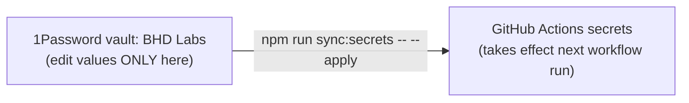

# Secrets runbook

Adapted from experiment-hub's `docs/SECRETS_RUNBOOK.md`. MVDS keeps only its
sync half: every secret here is a GitHub Actions secret. Nothing under `src/`
reads one, and there is no `.env` file, so the hub's `.env.local` pointers and
env-file guard have nothing to protect.

## Rotating a credential — your five steps

1. **Create the new value at the vendor** — links in [Where you rotate](#where-you-rotate).
2. **Paste it into the matching item** in the 1Password **BHD Labs** vault.
3. **Push it out:** `npm run sync:secrets` to preview, then
   `npm run sync:secrets -- --apply` to write.
4. **Verify** — ask Claude: *"verify the ⟨vendor⟩ credential."*
5. **Revoke the old one — always last.** Revoking first breaks CI while
   everything local keeps working, the most confusing failure available. GitHub
   values take effect on the next workflow run.

## The mental model

**One master copy; GitHub holds a derived one that the next sync overwrites.**

- The vault is the only place a value is **edited**. GitHub can't read the
  vault, so it holds a copy; editing that copy in GitHub's UI is wasted work,
  and the sync can't see it (it reports "unchanged" until the vault moves).
- What exists and where it lives: [`scripts/secrets.manifest.mjs`](../scripts/secrets.manifest.mjs)
  is the registry — names and vault references, never values.
- The sync never deletes. A GitHub secret the manifest doesn't list is
  reported as an **orphan** for a person to look at.

## What the preview tells you

| Mark | Means | Do |
| --- | --- | --- |
| `+` added | never written by this sync | apply |
| `~` updated | the vault value moved, the row gained a target, or a secret this sync wrote is missing from GitHub | apply — only the targets listed are written |
| `=` unchanged | what GitHub has is what the vault has | nothing |
| `?` not in vault | the vault field is missing, empty, or a placeholder (`PASTE_VALUE_HERE`) | fill the item |
| `! already set … replaces it for good` | first write to that target over a secret someone set by hand — including a target a row just gained | make sure the vault holds the value you want **before** applying — GitHub can't give the old one back |
| `! missing from … — restoring` | someone deleted a secret this sync wrote | apply puts it back; if the deletion was deliberate, remove the row or target instead |
| `! no workflow reads secrets.X` | the manifest manages a secret nothing uses yet | expected for the Vercel rows until #133 merges; otherwise, remove the row |
| `! X — in gh, not in the manifest` | an orphan | find out whether anything uses it, then add a row or delete it |
| `! X — read by …, but the manifest does not manage it` | a workflow depends on a secret with no master copy | add a row and a vault item |

## One-time setup

Create these items in **BHD Labs**. The field names must match the manifest's
`op://` references exactly.

| Item | Field | Value from |
| --- | --- | --- |
| `Chromatic mvds` | `project token` | Chromatic → the mvds project's settings (see below) |
| `Vercel mvds` | `token` | [vercel.com/account/settings/tokens](https://vercel.com/account/settings/tokens) — a new token for MVDS, not the hub's |
| `Vercel mvds` | `org id` | Vercel team settings → Team ID (`team_…`) |
| `Vercel mvds` | `project id` | the mvds project → Settings → General → Project ID (`prj_…`) |

Then preview, check every row reads `+`, and apply. The first apply over
`CHROMATIC_PROJECT_TOKEN` warns that it replaces a hand-set value; that is
expected, as long as the vault holds the current token.

## Where you rotate

| Vault item | You rotate at | Watch out |
| --- | --- | --- |
| Chromatic mvds | the mvds project on [chromatic.com](https://www.chromatic.com/start) → Manage → Configure | **Unverified:** whether regenerating revokes the old token at once. If it does, steps 3 and 5 happen together — push in the same sitting. Whoever rotates it first, record the answer here. |
| Vercel mvds — token | [account → tokens](https://vercel.com/account/settings/tokens) | tokens are never re-viewable; scope it to the team |
| Vercel mvds — ids | nowhere — they don't rotate | they change only if the project is recreated |

Verification after a push is Claude's job — just ask **"verify the ⟨vendor⟩ credential."**

## If 1Password is unavailable

The sync stops with *"Cannot read vault 'BHD Labs'"*. The readiness check is
`op vault list` (`op whoami` lies under app integration). Causes, in order:

1. **The app is quit or locked.** Open it.
2. **The integration toggle is off.** Turn on 1Password Settings → Developer →
   *Integrate with 1Password CLI*, then ⌘Q and reopen.
3. **macOS is denying the calling app.** `op` says "No accounts configured" with
   everything turned on. Run from a terminal that has the grant, or check
   System Settings → Privacy & Security.

---

## Agent notes

Reference for Claude; the human playbook ends above this line.

### Verification map

| Credential | Verified by |
| --- | --- |
| Chromatic | a run of `chromatic.yml` reaching the upload step (re-run the latest one on main) |
| Vercel | a run of `deploy-site.yml` that deploys rather than skipping; its step summary says which |

### Gotchas, from the hub

- **GitHub secrets are write-only.** `gh secret list` returns names and dates,
  never values. The vault is the only recoverable copy, so a sync over a
  hand-set secret destroys the old value for good — hence the `replaces` warning.
- **Environment secrets hide.** `gh secret list` shows repo secrets only; add
  `--env <name>` for an environment's. This repo has `Preview`, `Production` and
  `copilot` environments, all empty on 2026-11-09.
- **The token `gh` uses must be allowed to write secrets.** For a fine-grained
  PAT that is `Secrets: Read and write`; `Actions` permission isn't enough.
- **`op item create` writes epoch dates.** Set `valid from`/`expires` explicitly,
  or 1Password badges the item as expired since 1969.
- **The state file is per machine, and per target.** `.secrets-sync-state`
  (hashes only, gitignored) records what this sync last wrote to each target,
  so a write that fails part-way leaves an accurate record. It lives in the
  main checkout, so every worktree on this machine
  shares it; another machine starts empty and sees every row as `+` with
  `replaces` warnings. That is safe as long as the vault is current.
